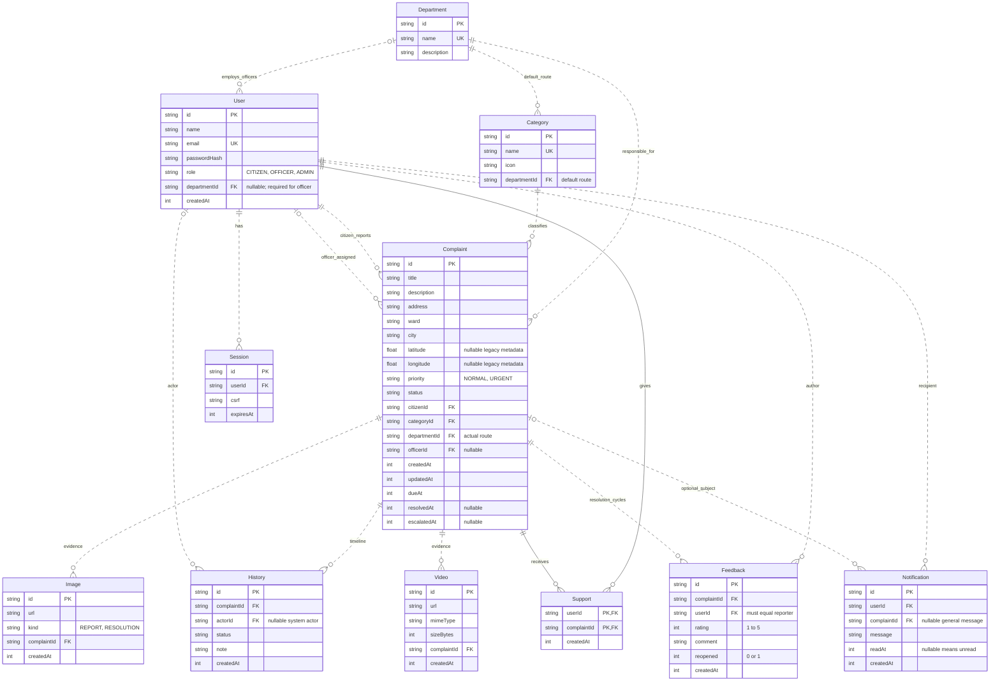

# CP2 — Physical ER diagram

This diagram describes **the runnable 11-table schema**, including its two documented compatibility redundancies. The separate fully normalized logical endpoint is in [CP1, sections 6–9](01_normalization.md). IDs are application-supplied strings; timestamp attributes are integer UTC epoch milliseconds. `PK` is primary key, `UK` is unique key and `FK` is foreign key. `Support` has a composite PK.

Cardinality details:

- A department has zero or more officers/categories/complaints. Users have zero or one department; officers must have exactly one. Non-officers have none in this educational DDL.
- Every complaint has one citizen, category and responsible department, with zero or one assigned officer. Assignment can differ from the category's default department, but the chosen officer must belong to the responsible department.
- Complaint child collections are all zero-to-many, including feedback across reopen cycles. Support resolves the user–complaint many-to-many relationship; duplicate pairs are forbidden.
- A history actor can be absent for system escalation. A notification can be unrelated to a complaint, but always has one recipient.
- Current status uses a checked string domain: `SUBMITTED`, `ASSIGNED`, `IN_PROGRESS`, `RESOLVED`, `CLOSED`, `REOPENED`. There is no physical Status table. Full transition authorization, photo requirements and history append behavior belong to the transaction/service layer.

Delete/update behavior and added constraints are documented in [schema alignment](../docs/schema-alignment.md). No map or heatmap entity exists.
